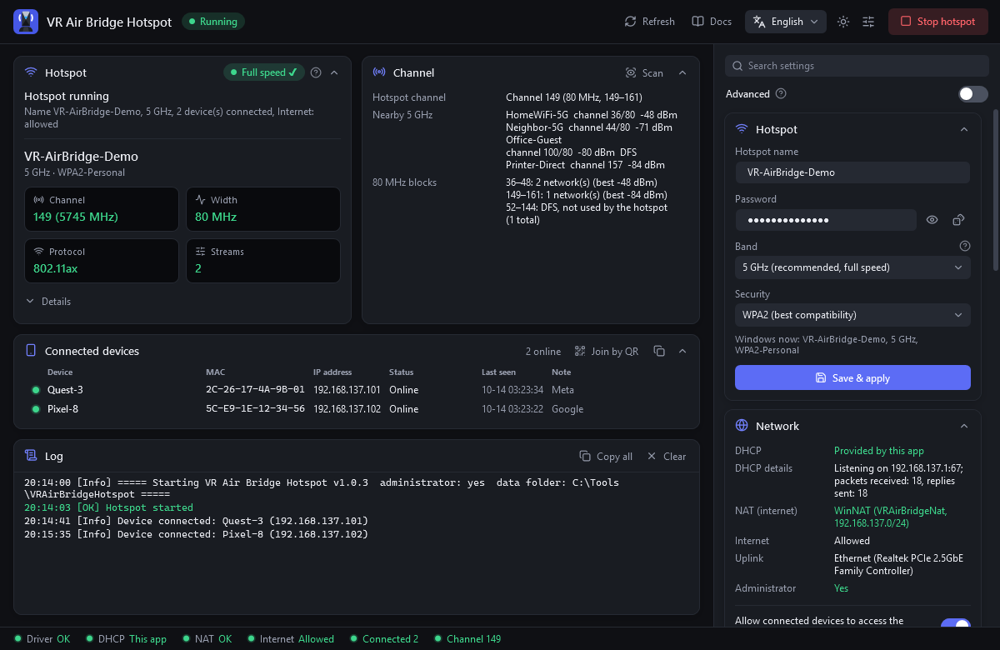
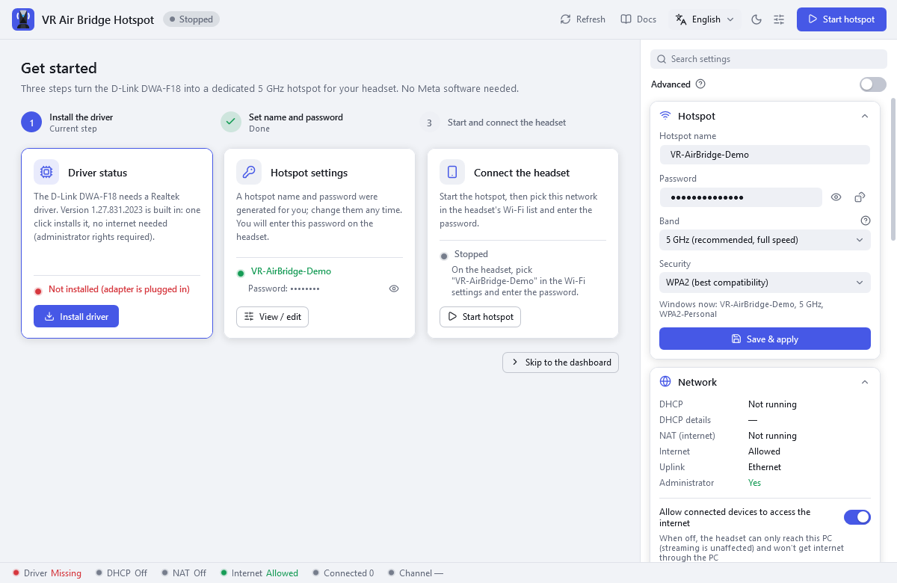
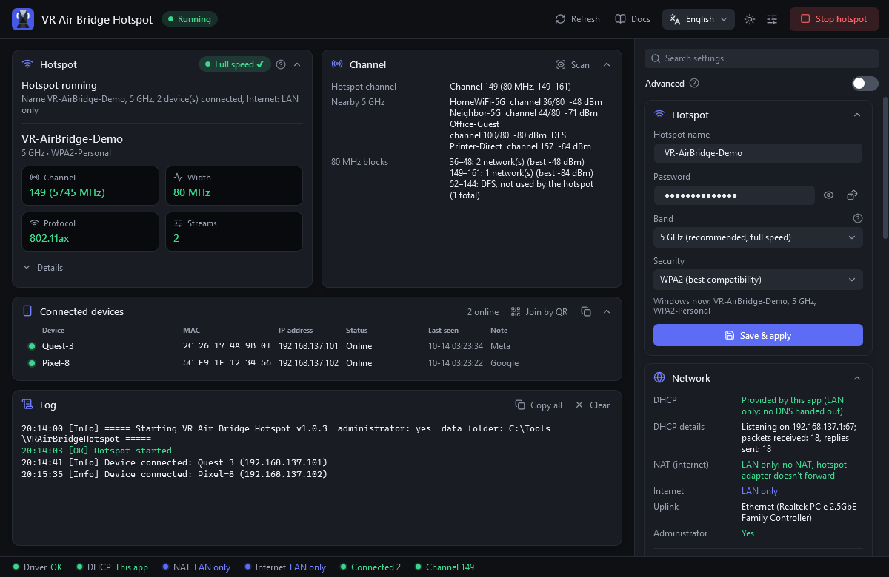
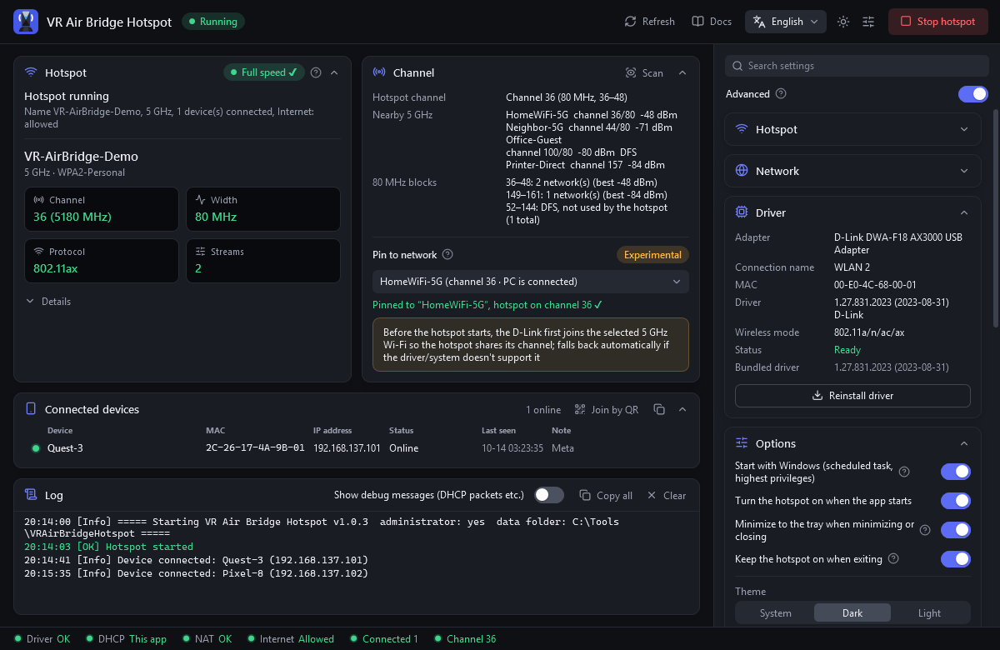
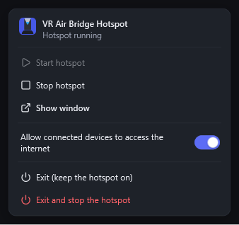
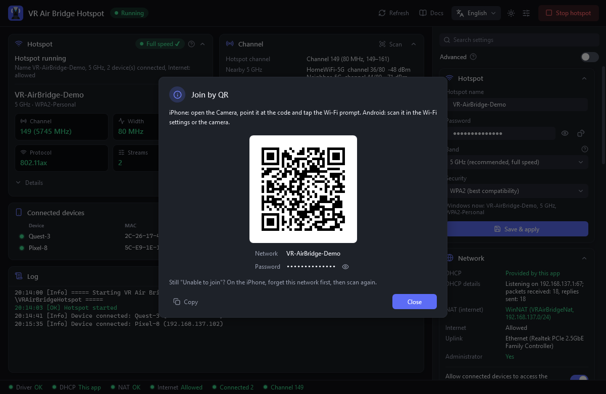
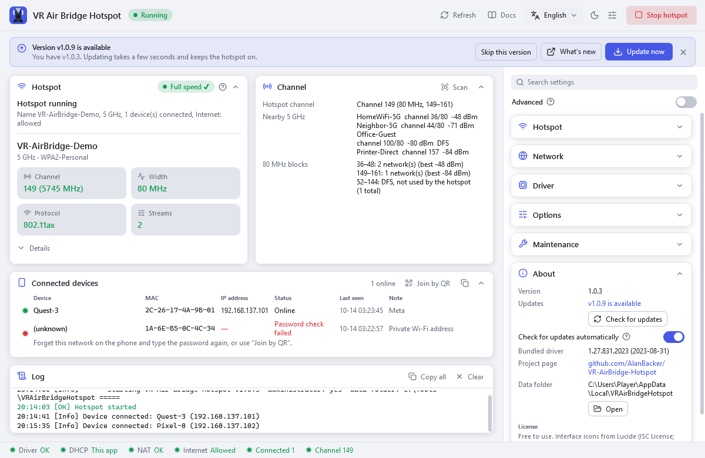

<p align="center">
  
</p>

# VR Air Bridge Hotspot

**English** · [简体中文](docs/README.zh-CN.md) · [日本語](docs/README.ja.md) · [한국어](docs/README.ko.md)

[](https://github.com/AlanBacker/VR-AirBridge-Hotspot/releases/latest)
[](https://github.com/AlanBacker/VR-AirBridge-Hotspot/actions/workflows/build.yml)
[](LICENSE)

Turns the D-Link DWA-F18 (Meta's "VR Air Bridge", Realtek RTL8852AU) into a standalone 5 GHz / 80 MHz / Wi-Fi 6 / 2×2 hotspot for streaming PC VR to a Quest.
No Meta software is needed, and the PC's own Wi-Fi stays connected.

<p align="center">
  
</p>

## Features

- **Beacon check**: reads channel, width, protocol and spatial streams from the hotspot's real beacon (needs a second Wi-Fi adapter).
- **Own DHCP and NAT**: devices get an address and internet without relying on Windows ICS.
- **Internet switch**: turn off *Allow connected devices to access the internet* for LAN only; streaming keeps working.
- **Bundled driver**: *Install driver* restores the driver that Meta's uninstaller removes.
- **Channel panel**: nearby 5 GHz networks per 80 MHz block, plus the experimental *Pin to network*.
- **Watchdog and tray**: a dropped hotspot is restarted, and the app keeps running in the tray.
- **Join help**: the device list says why a phone could not join (wrong password, dropped right after joining, no address). **Join by QR** shows a code to scan instead of typing the password.
- **Updates**: checks GitHub for a new version once a day. **Update now** downloads it, verifies its SHA-256 and restarts in seconds while the hotspot stays on.
- **One-click tools**: *One-click optimize*, *Repair network*, *Revert / uninstall*.
- **4 languages** (English, 简体中文, 日本語, 한국어), dark and light themes.

## Requirements

- Windows 10 2004 or later, or Windows 11, 64-bit.
- The D-Link DWA-F18, plus a second adapter (Wi-Fi or Ethernet) that keeps the PC online.
- Administrator rights.

## Quick start

1. Download `VRAirBridgeHotspot-Setup.exe` from [Releases](https://github.com/AlanBacker/VR-AirBridge-Hotspot/releases) and install it, or take the portable `VRAirBridgeHotspot.exe` (single file). If SmartScreen appears, click **More info → Run anyway** (both are unsigned).
2. Run it and confirm the administrator prompt.
3. Plug in the DWA-F18; if it has no driver, click **Install driver**.
4. The first run sets the name `AirBridge-XXXX` and a random password. To change them, edit **Hotspot** in the sidebar and click **Save & apply**.
5. Click **Start hotspot** and connect the headset (it gets `192.168.137.100–199`). Then pick this PC in your streaming app (Virtual Desktop, Steam Link, …).

To remove it, uninstall it in **Settings → Apps**; it undoes its system changes first. With the portable exe, click **Revert / uninstall**, then delete the exe.

<table>
  <tr>
    <td align="center" width="50%"><br>Setup</td>
    <td align="center" width="50%"><br>LAN-only</td>
  </tr>
  <tr>
    <td align="center"><br>Channel</td>
    <td align="center"><br>Tray</td>
  </tr>
  <tr>
    <td align="center"><br>Join by QR</td>
    <td align="center"><br>Update</td>
  </tr>
</table>

## Settings

Settings live in `%LocalAppData%\VRAirBridgeHotspot\config.json` (logs too), and most can be changed in the app. Files that v1.0.2 and earlier kept next to the exe move there on the first start. After editing the file by hand, click **Save & apply** or restart the app.

| Key | Default | Meaning |
|---|---|---|
| `ssid` | `AirBridge-XXXX` | Hotspot name (XXXX = last 4 digits of the dongle's MAC) |
| `password` | random, 12 chars | Hotspot password, 8–63 ASCII characters |
| `band` | `5GHz` | `5GHz`, `2.4GHz` or `Auto` |
| `internet.allow` | `true` | `false` = LAN only |
| `channel.pinSsid` | `""` | Wi-Fi for *Pin to network*; empty = off |
| `dhcp.*` | `auto`, `.100`–`.199`, 12 h | When the app serves DHCP (`auto` / `always` / `off`), pool, lease, fallback DNS |
| `nat.*` | `auto`, `VRAirBridgeNat` | NAT mode (`auto` / `off`) and WinNAT name |
| `ui.language` | `auto` | `en`, `zh-CN`, `ja`, `ko`; `auto` follows Windows |
| `ui.theme` | `system` | `dark`, `light`; `system` follows Windows |
| `update.autoCheck` | `true` | `false` = no automatic update check (**Check for updates** in About still works) |

## Command line

It is a window app: to see output and exit codes, run `start /wait VRAirBridgeHotspot.exe <option>` in an administrator Command Prompt.

| Option | Effect |
|---|---|
| `--diag [file]` | Saves diagnostics (no passwords) to a file, in the data folder by default, and exits |
| `--driver-status` | Driver state; exit code 0 installed, 1 plugged in without driver, 2 not plugged in, 3 query failed |
| `--install-driver` | Installs the bundled driver |
| `--internet on\|off` | Allows or blocks internet for connected devices, instantly if the app is running |
| `--lang xx` | Uses `en`, `zh-CN`, `ja` or `ko` for this run only |
| `--uninstall` | Undoes the app's system changes (same as *Revert / uninstall*) |

## Troubleshooting

- **Headset gets 169.254.x.x**: click **Repair network** (it handles the Hyper-V *Default Switch*); a third-party firewall such as Kaspersky must trust the hotspot network.
- **iPhone says "Unable to join"**: read the hint in the device list first. Usually it helps to tap *Forget This Network* on the iPhone and join again with **Join by QR**. If it still drops at once, turn off *Private Wi-Fi Address* for this network or try 2.4 GHz.
- **Hotspot on the wrong adapter**: the app detects it by MAC address and moves it to the DWA-F18 without touching the adapter that keeps the PC online.
- **Not full speed (2.4 GHz or 20 MHz)**: set **Band** to 5 GHz, run **One-click optimize**, replug the dongle and start again.
- **Driver gone after uninstalling Meta software**: click **Install driver**.
- **Another Meta bridge nearby on the same channel**: use **Pin to network** with a saved Wi-Fi in the other 80 MHz block.
- **Picking a channel**: Windows chooses it, always within 36–48 or 149–161; **Pin to network** is the only way to steer it.

## Privacy

Everything runs locally and there is no telemetry. The app only contacts GitHub: to check for updates (can be turned off in **About**) and to download one when you click **Update now**.

`config.json` stores the hotspot password in plain text. It stays in your user profile, so the exe can be shared as is. Diagnostics leave out passwords but list nearby Wi-Fi names.

## Build

Requires the .NET 9 SDK; the second line builds `dist/VRAirBridgeHotspot-Setup.exe` with [Inno Setup 6](https://jrsoftware.org/isinfo.php).

```
dotnet publish src/VRAirBridge.App/VRAirBridge.App.csproj -c Release -o dist
iscc installer/VRAirBridgeHotspot.iss
```

## License

MIT, see [LICENSE](LICENSE). The bundled Realtek/D-Link driver (1.27.831.2023, WHQL-signed) is redistributed unmodified; it is © Realtek and not covered by the MIT license.

Design language from [VRChat DLSS5 Cam](https://github.com/AlanBacker/VRChat-DLSS5-Cam); icons by [Lucide](https://lucide.dev) (ISC).
