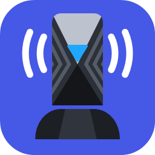
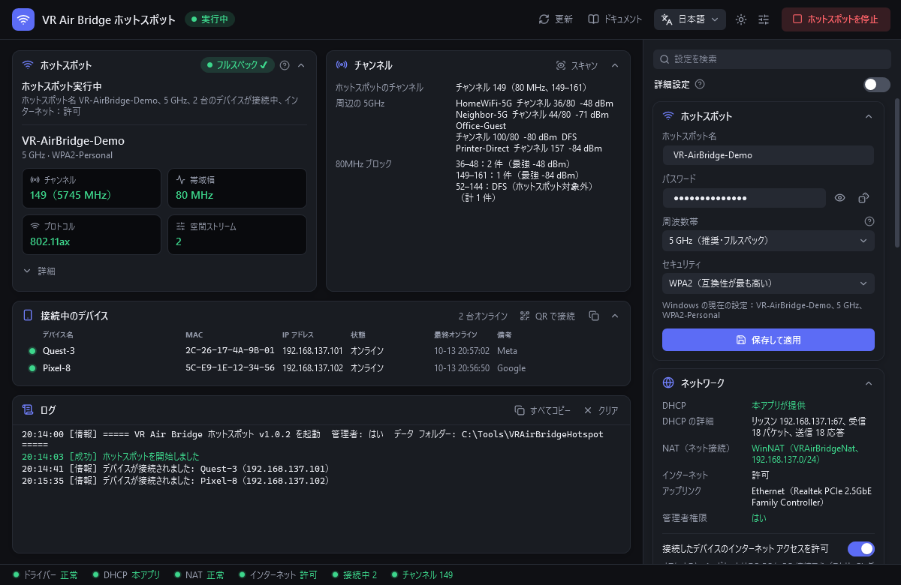
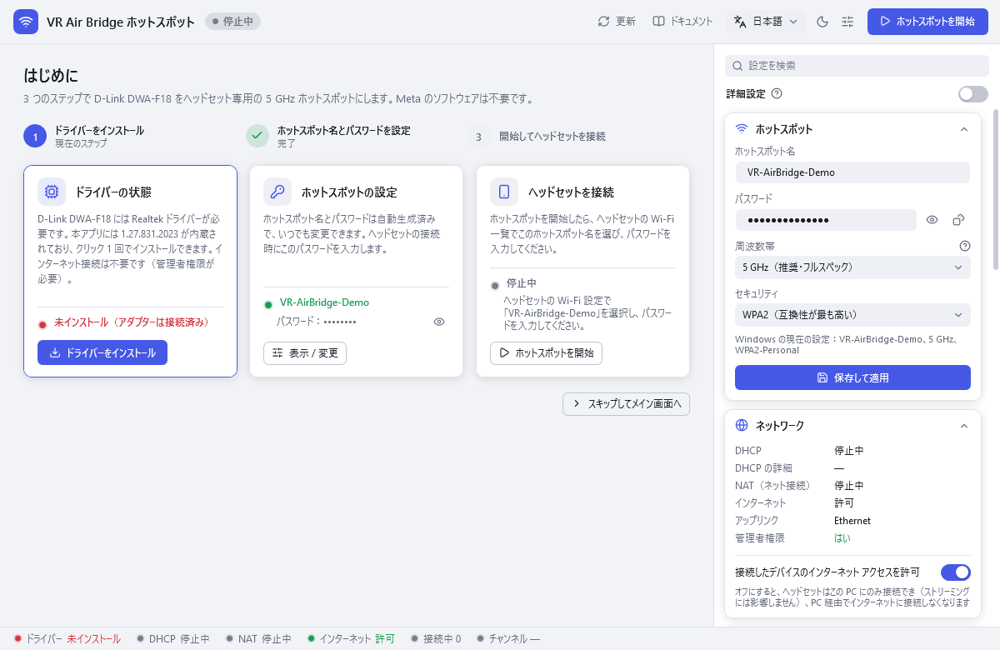
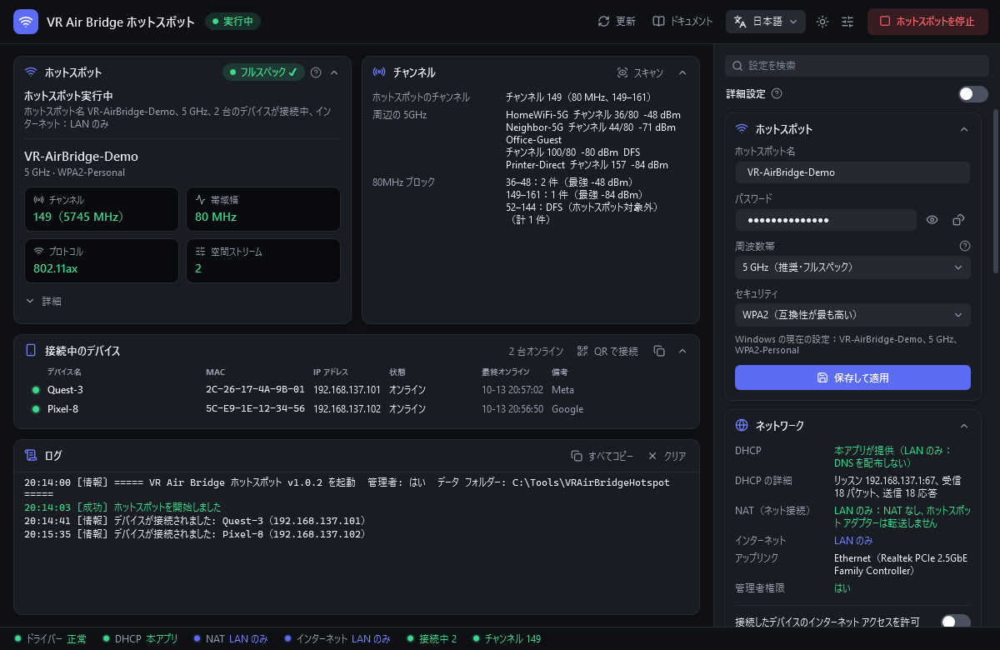
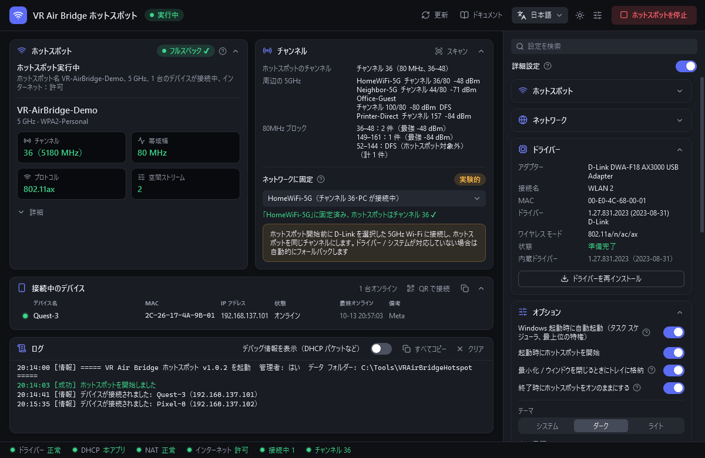
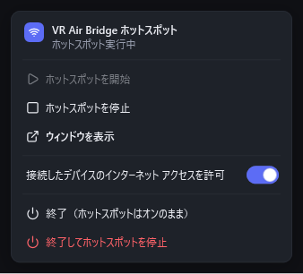
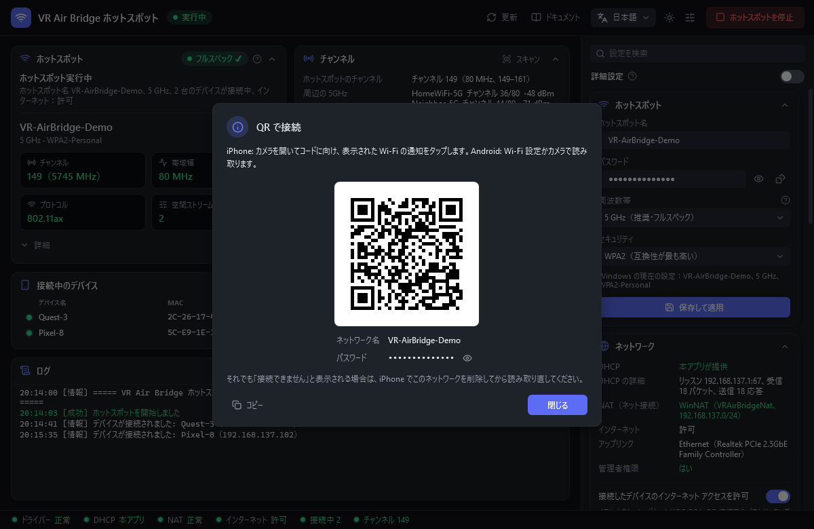
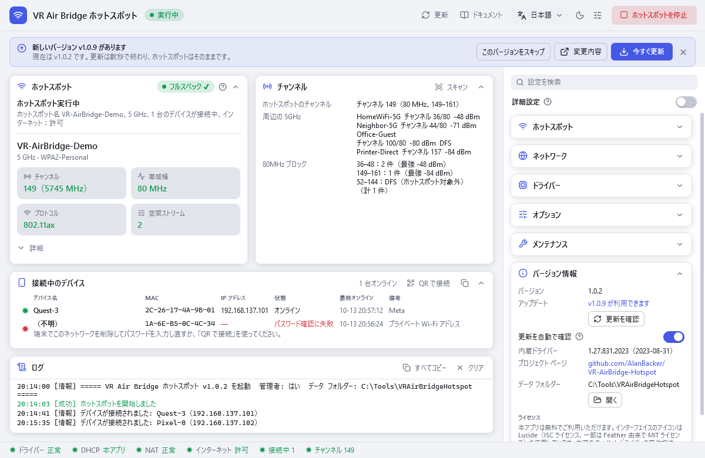

<p align="center">
  
</p>

# VR Air Bridge ホットスポット

[English](../README.md) · [简体中文](README.zh-CN.md) · **日本語** · [한국어](README.ko.md)

[](https://github.com/AlanBacker/VR-AirBridge-Hotspot/releases/latest)
[](https://github.com/AlanBacker/VR-AirBridge-Hotspot/actions/workflows/build.yml)
[](../LICENSE)

D-Link DWA-F18（Meta の「VR Air Bridge」、Realtek RTL8852AU）を、Quest で PC VR をストリーミングするための独立した 5 GHz / 80 MHz / Wi-Fi 6 / 2×2 ホットスポットにします。
Meta のソフトウェアは不要で、PC 本体の Wi-Fi 接続もそのまま使えます。

<p align="center">
  
</p>

## 機能

- **ビーコンの確認**：実際のビーコンからチャンネル、帯域幅、プロトコル、空間ストリーム数を読み取ります（2 枚目の無線アダプターが必要）。
- **独自の DHCP と NAT**：Windows のインターネット接続の共有（ICS）に頼らずに、アドレス配布とインターネット接続を行います。
- **インターネットの切り替え**：「接続したデバイスのインターネット アクセスを許可」をオフにすると LAN のみになり、ストリーミングはそのまま使えます。
- **ドライバー内蔵**：Meta のアンインストーラーが消すドライバーを「ドライバーをインストール」で戻せます。
- **チャンネル パネル**：周辺の 5GHz Wi-Fi を 80MHz ブロックごとに表示し、実験的な「ネットワークに固定」も使えます。
- **ウォッチドッグとトレイ**：切れたホットスポットを自動で再開し、ウィンドウを閉じてもトレイで動き続けます。
- **接続の診断**：スマートフォンがつながらない理由（パスワード違い、接続直後の切断、アドレス未取得）をデバイス一覧に表示します。「QR で接続」のコードを読み取れば、パスワードを入力せずに参加できます。
- **自動更新**：1 日 1 回 GitHub で新しいバージョンを確認します。「今すぐ更新」でダウンロードと SHA-256 の検証を行い、数秒で再起動します（ホットスポットは切れません）。
- **ワンクリック ツール**：ワンクリック最適化、ネットワークを修復、元に戻す / アンインストール。
- **4 言語の UI**（English、简体中文、日本語、한국어）、ダーク / ライト テーマ。

## 動作環境

- Windows 10 2004 以降または Windows 11（64 ビット）。
- D-Link DWA-F18 と、PC をインターネットにつなぐもう 1 つのアダプター（Wi-Fi または有線 LAN）。
- 管理者権限。

## クイック スタート

1. [Releases](https://github.com/AlanBacker/VR-AirBridge-Hotspot/releases) から `VRAirBridgeHotspot.exe` をダウンロードし、決まったフォルダーに置きます（1 ファイルのみ、インストール不要）。SmartScreen が表示されたら「詳細情報」→「実行」をクリックします（exe は未署名です）。
2. ダブルクリックで起動し、管理者の確認で「はい」をクリックします。
3. DWA-F18 を挿し、ドライバーがないと表示されたら「ドライバーをインストール」をクリックします。
4. 初回起動時にホットスポット名 `AirBridge-XXXX` とランダムなパスワードが設定されます。変更するときは右側のサイドバーの「ホットスポット」で編集し、「保存して適用」をクリックします。
5. 「ホットスポットを開始」をクリックし、ヘッドセットを接続します（アドレスは `192.168.137.100–199`）。あとはストリーミング アプリ（Virtual Desktop、Steam Link など）でこの PC を選びます。

<table>
  <tr>
    <td align="center" width="50%"><br>はじめに</td>
    <td align="center" width="50%"><br>LAN のみ</td>
  </tr>
  <tr>
    <td align="center"><br>チャンネル</td>
    <td align="center"><br>トレイ</td>
  </tr>
  <tr>
    <td align="center"><br>QR で接続</td>
    <td align="center"><br>更新</td>
  </tr>
</table>

## 設定

設定は exe と同じフォルダーの `config.json` に保存され、ほとんどはアプリ内で変更できます。手で編集した後は「保存して適用」をクリックするか、アプリを再起動してください。

| キー | 既定値 | 内容 |
|---|---|---|
| `ssid` | `AirBridge-XXXX` | ホットスポット名（XXXX は DWA-F18 の MAC アドレス末尾 4 桁） |
| `password` | ランダム 12 文字 | パスワード、半角英数字・記号 8～63 文字 |
| `band` | `5GHz` | `5GHz` / `2.4GHz` / `Auto` |
| `internet.allow` | `true` | `false` で LAN のみ |
| `channel.pinSsid` | `""` | 「ネットワークに固定」の Wi-Fi。空なら固定しない |
| `dhcp.*` | `auto`、`.100`～`.199`、12 時間 | 本アプリが DHCP を行う条件（`auto` / `always` / `off`）、アドレス プール、リース期間、代替 DNS |
| `nat.*` | `auto`、`VRAirBridgeNat` | NAT モード（`auto` / `off`）と WinNAT 名 |
| `ui.language` | `auto` | `en` / `zh-CN` / `ja` / `ko`。`auto` は Windows に合わせる |
| `ui.theme` | `system` | `dark` / `light`。`system` は Windows に合わせる |
| `update.autoCheck` | `true` | `false` = 更新を自動で確認しない（「バージョン情報」の「更新を確認」は使えます） |

## コマンド ライン

ウィンドウ アプリなので、出力と終了コードを見るには管理者のコマンド プロンプトで `start /wait VRAirBridgeHotspot.exe <オプション>` を実行します。

| オプション | 動作 |
|---|---|
| `--diag [ファイル]` | 診断情報（パスワードを除く）をファイル（既定は exe の隣）に保存して終了 |
| `--driver-status` | ドライバーの状態。終了コード 0 インストール済み、1 接続済みだがドライバーなし、2 未接続、3 取得失敗 |
| `--install-driver` | 内蔵ドライバーをインストール |
| `--internet on\|off` | 接続したデバイスのインターネット アクセスを許可 / 禁止。アプリ実行中なら即時反映 |
| `--lang xx` | 今回だけ `en` / `zh-CN` / `ja` / `ko` で表示 |
| `--uninstall` | 本アプリによるシステムの変更を元に戻す（「元に戻す / アンインストール」と同じ） |

## トラブルシューティング

- **ヘッドセットのアドレスが 169.254.x.x**：「ネットワークを修復」をクリックします（Hyper-V の Default Switch にも対応）。Kaspersky などのファイアウォールでは、ホットスポットのネットワークを信頼済みにしてください。
- **iPhone で「接続できません」**：まずデバイス一覧のヒントを確認します。多くの場合、iPhone で「このネットワーク設定を削除」してから「QR で接続」で参加し直せば解決します。それでもすぐ切れる場合は、このネットワークの「プライベート Wi-Fi アドレス」をオフにするか、2.4 GHz を試してください。
- **ホットスポットが別のアダプターで始まった**：アプリが MAC アドレスで検出して DWA-F18 に移します。PC のインターネット接続に使っているアダプターには触れません。
- **フルスペックにならない（2.4 GHz や 20 MHz）**：「周波数帯」を 5 GHz にして「ワンクリック最適化」を実行し、DWA-F18 を挿し直してから開始し直します。
- **Meta のソフトをアンインストールしたらドライバーが消えた**：「ドライバーをインストール」をクリックします。
- **近くの別の Meta ブリッジと同じチャンネル**：「ネットワークに固定」で、もう一方の 80MHz ブロックにある保存済みの Wi-Fi を選びます。
- **チャンネルを指定したい**：Windows が 36～48 か 149～161 の中から選びます。影響を与えられるのは「ネットワークに固定」だけです。

## プライバシー

処理はすべて PC 内で完結し、テレメトリーもありません。アプリが通信するのは GitHub だけです（更新の確認と、「今すぐ更新」をクリックしたときのダウンロード）。確認は「バージョン情報」でオフにできます。

`config.json` にはホットスポットのパスワードが平文で保存されるので、共有するのは exe だけにしてください。診断情報にパスワードは含まれませんが、周辺の Wi-Fi 名は含まれます。

## ビルド

.NET 9 SDK が必要です。

```
dotnet publish src/VRAirBridge.App/VRAirBridge.App.csproj -c Release
```

## ライセンス

MIT ライセンスです（[LICENSE](../LICENSE)）。同梱の Realtek/D-Link ドライバー（1.27.831.2023、WHQL 署名済み）は改変せずに再配布しているもので、著作権は Realtek にあり MIT ライセンスの対象外です。

デザイン言語は [VRChat DLSS5 Cam](https://github.com/AlanBacker/VRChat-DLSS5-Cam) を踏襲しています。アイコンは [Lucide](https://lucide.dev)（ISC）です。
