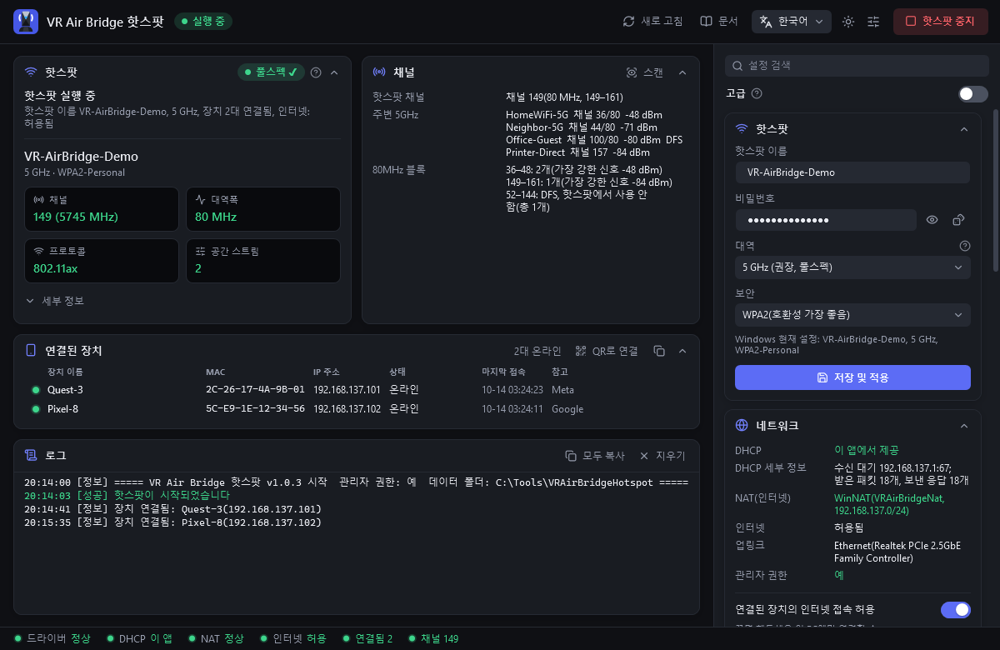
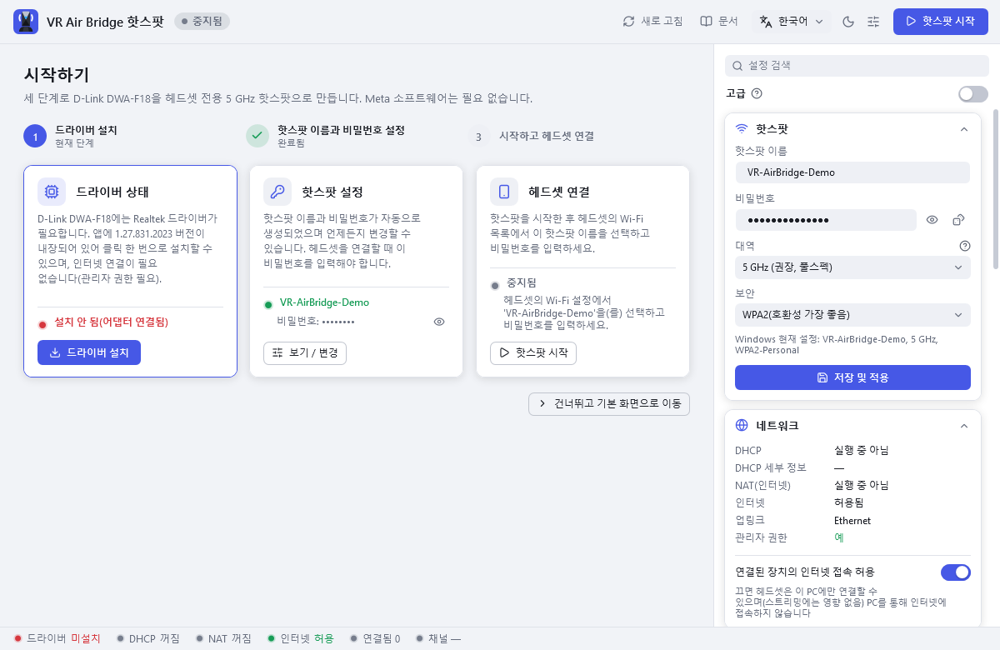
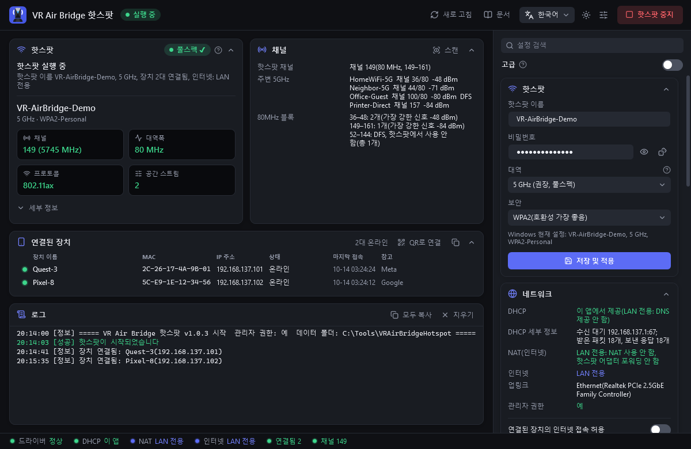
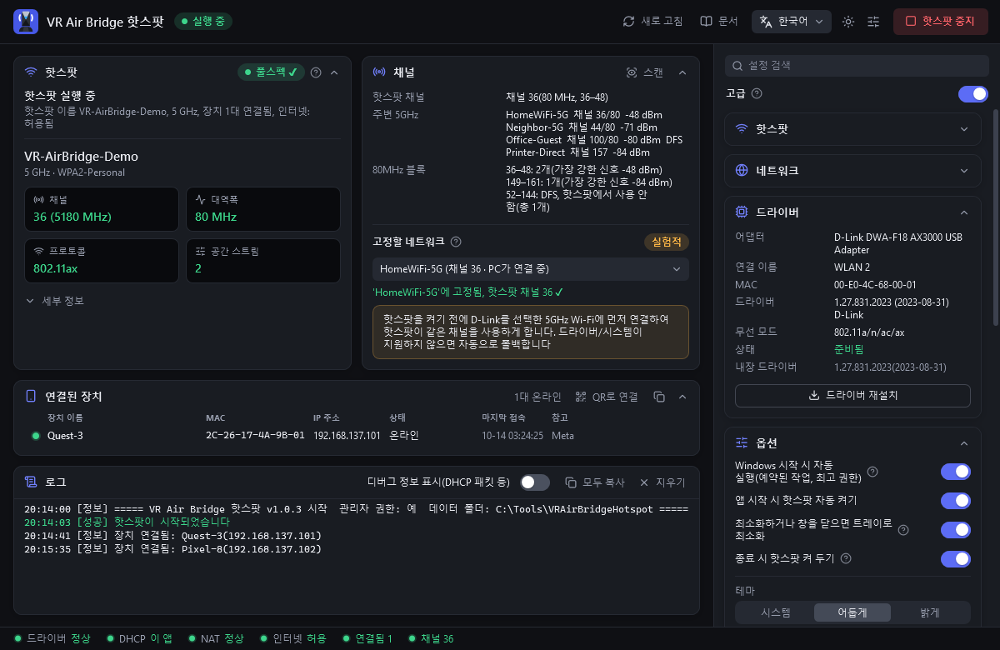
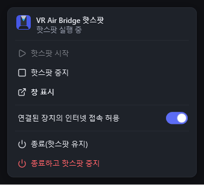
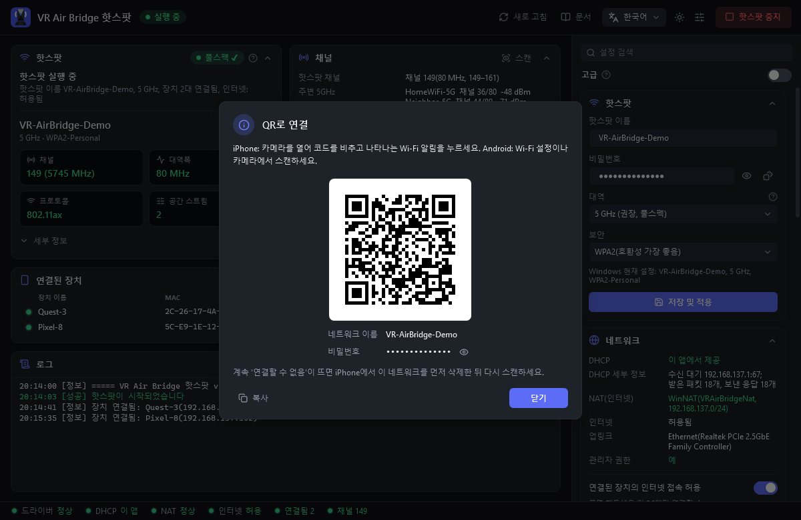
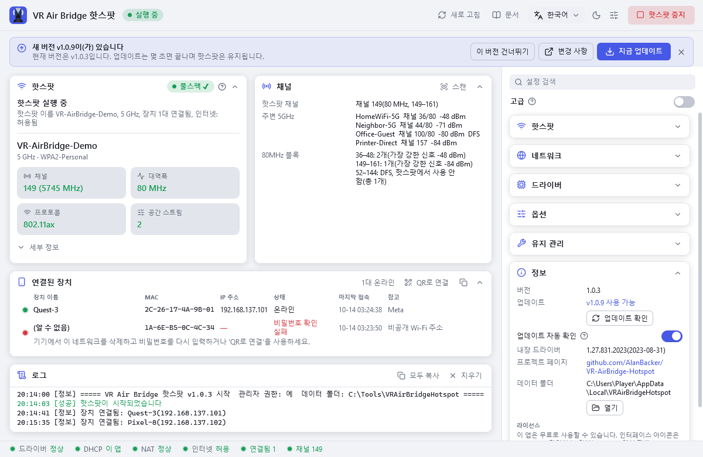

<p align="center">
  
</p>

# VR Air Bridge 핫스팟

[English](../README.md) · [简体中文](README.zh-CN.md) · [日本語](README.ja.md) · **한국어**

[](https://github.com/AlanBacker/VR-AirBridge-Hotspot/releases/latest)
[](https://github.com/AlanBacker/VR-AirBridge-Hotspot/actions/workflows/build.yml)
[](../LICENSE)

D-Link DWA-F18(Meta의 'VR Air Bridge', Realtek RTL8852AU)을 Quest PC VR 스트리밍용 독립 5 GHz / 80 MHz / Wi-Fi 6 / 2×2 핫스팟으로 만듭니다.
Meta 소프트웨어가 필요 없고, PC 자체의 Wi-Fi 연결도 그대로 유지됩니다.

<p align="center">
  
</p>

## 기능

- **비콘 확인**: 실제 비콘에서 채널, 대역폭, 프로토콜, 공간 스트림 수를 읽어 옵니다(두 번째 무선 어댑터 필요).
- **자체 DHCP와 NAT**: Windows 인터넷 연결 공유(ICS)에 의존하지 않고 주소 배포와 인터넷 연결을 처리합니다.
- **인터넷 스위치**: '연결된 장치의 인터넷 접속 허용'을 끄면 LAN 전용이 되고, 스트리밍은 그대로 됩니다.
- **드라이버 내장**: Meta 제거 프로그램이 지우는 드라이버를 '드라이버 설치'로 되살립니다.
- **채널 패널**: 주변 5GHz Wi-Fi를 80MHz 블록별로 보여 주며, 실험 기능 '고정할 네트워크'도 있습니다.
- **워치독과 트레이**: 끊긴 핫스팟을 자동으로 다시 켜고, 창을 닫아도 트레이에서 계속 실행됩니다.
- **연결 진단**: 휴대폰이 연결되지 않는 이유(비밀번호 오류, 연결 직후 끊김, 주소 미할당)를 장치 목록에 표시합니다. 'QR로 연결'의 코드를 스캔하면 비밀번호를 입력하지 않고 접속할 수 있습니다.
- **자동 업데이트**: 하루 한 번 GitHub에서 새 버전을 확인합니다. '지금 업데이트'를 누르면 내려받아 SHA-256을 검증하고 몇 초 안에 다시 시작합니다(핫스팟은 유지).
- **원클릭 도구**: 원클릭 최적화, 네트워크 복구, 되돌리기 / 제거.
- **UI 4개 언어**(English, 简体中文, 日本語, 한국어), 어두운 / 밝은 테마.

## 요구 사항

- Windows 10 2004 이상 또는 Windows 11, 64비트.
- D-Link DWA-F18, 그리고 PC 인터넷 연결용 어댑터 하나 더(Wi-Fi 또는 유선).
- 관리자 권한.

## 빠른 시작

1. [Releases](https://github.com/AlanBacker/VR-AirBridge-Hotspot/releases)에서 `VRAirBridgeHotspot-Setup.exe`를 내려받아 설치하거나, 포터블 `VRAirBridgeHotspot.exe`(파일 하나)를 사용합니다. SmartScreen 창이 뜨면 '추가 정보' → '실행'을 클릭합니다(둘 다 서명되지 않음).
2. 더블클릭해 실행하고 관리자 확인 창에서 '예'를 클릭합니다.
3. DWA-F18을 꽂고, 드라이버가 없다고 나오면 '드라이버 설치'를 클릭합니다.
4. 처음 실행하면 핫스팟 이름 `AirBridge-XXXX`와 임의 비밀번호가 설정됩니다. 바꾸려면 오른쪽 사이드바의 '핫스팟'에서 수정하고 '저장 및 적용'을 클릭합니다.
5. '핫스팟 시작'을 클릭하고 헤드셋을 연결합니다(주소는 `192.168.137.100–199`). 그다음 스트리밍 앱(Virtual Desktop, Steam Link 등)에서 이 PC를 선택합니다.

제거하려면 '설정 → 앱'에서 제거하세요. 먼저 시스템 변경을 되돌립니다. 포터블 버전은 '되돌리기 / 제거'를 클릭한 뒤 exe를 삭제합니다.

<table>
  <tr>
    <td align="center" width="50%"><br>시작하기</td>
    <td align="center" width="50%"><br>LAN 전용</td>
  </tr>
  <tr>
    <td align="center"><br>채널</td>
    <td align="center"><br>트레이</td>
  </tr>
  <tr>
    <td align="center"><br>QR로 연결</td>
    <td align="center"><br>업데이트</td>
  </tr>
</table>

## 설정

설정은 `%LocalAppData%\VRAirBridgeHotspot\config.json`에 저장되며(로그도 같은 곳), 대부분 앱에서 바꿀 수 있습니다. v1.0.2 이하가 exe 옆에 두던 파일은 처음 시작할 때 그곳으로 옮겨집니다. 파일을 직접 편집한 뒤에는 '저장 및 적용'을 클릭하거나 앱을 다시 시작하세요.

| 키 | 기본값 | 의미 |
|---|---|---|
| `ssid` | `AirBridge-XXXX` | 핫스팟 이름(XXXX는 DWA-F18 MAC 주소 끝 4자리) |
| `password` | 임의 12자 | 핫스팟 비밀번호, 영문·숫자·기호 8~63자 |
| `band` | `5GHz` | `5GHz` / `2.4GHz` / `Auto` |
| `internet.allow` | `true` | `false`면 LAN 전용 |
| `channel.pinSsid` | `""` | '고정할 네트워크'의 Wi-Fi. 비우면 고정 안 함 |
| `dhcp.*` | `auto`, `.100`~`.199`, 12시간 | 이 앱이 DHCP를 맡는 조건(`auto` / `always` / `off`), 주소 풀, 임대 기간, 대체 DNS |
| `nat.*` | `auto`, `VRAirBridgeNat` | NAT 모드(`auto` / `off`)와 WinNAT 이름 |
| `ui.language` | `auto` | `en` / `zh-CN` / `ja` / `ko`. `auto`는 Windows 설정 따르기 |
| `ui.theme` | `system` | `dark` / `light`. `system`은 Windows 설정 따르기 |
| `update.autoCheck` | `true` | `false` = 업데이트 자동 확인 끄기('정보'의 '업데이트 확인'은 계속 사용 가능) |

## 명령줄

창 앱이므로 출력과 종료 코드를 보려면 관리자 명령 프롬프트에서 `start /wait VRAirBridgeHotspot.exe <옵션>`으로 실행합니다.

| 옵션 | 동작 |
|---|---|
| `--diag [파일]` | 진단 정보(비밀번호 제외)를 파일(기본: 데이터 폴더)에 저장하고 종료 |
| `--driver-status` | 드라이버 상태. 종료 코드 0 설치됨, 1 꽂혀 있으나 드라이버 없음, 2 꽂혀 있지 않음, 3 조회 실패 |
| `--install-driver` | 내장 드라이버 설치 |
| `--internet on\|off` | 연결된 장치의 인터넷 접속 허용 / 차단. 앱이 실행 중이면 즉시 적용 |
| `--lang xx` | 이번 실행에만 `en` / `zh-CN` / `ja` / `ko` 사용 |
| `--uninstall` | 이 앱이 바꾼 시스템 설정을 되돌림('되돌리기 / 제거'와 같음) |

## 문제 해결

- **헤드셋 주소가 169.254.x.x**: '네트워크 복구'를 클릭합니다(Hyper-V의 Default Switch도 처리). Kaspersky 같은 방화벽에서는 핫스팟 네트워크를 신뢰할 수 있는 네트워크로 지정하세요.
- **iPhone에 '연결할 수 없음' 표시**: 먼저 장치 목록의 안내를 확인하세요. 대부분 iPhone에서 '이 네트워크 설정 지우기' 후 'QR로 연결'로 다시 접속하면 해결됩니다. 그래도 바로 끊기면 이 네트워크의 '개인 Wi-Fi 주소'를 끄거나 2.4 GHz로 시도해 보세요.
- **핫스팟이 다른 어댑터에서 켜짐**: 앱이 MAC 주소로 감지해 DWA-F18로 옮깁니다. PC 인터넷 연결에 쓰는 어댑터는 건드리지 않습니다.
- **풀스펙이 아님(2.4 GHz 또는 20 MHz)**: '대역'을 5 GHz로 바꾸고 '원클릭 최적화'를 실행한 뒤, DWA-F18을 다시 꽂고 핫스팟을 다시 시작합니다.
- **Meta 소프트웨어 제거 후 드라이버가 사라짐**: '드라이버 설치'를 클릭합니다.
- **근처의 다른 Meta 브리지와 같은 채널**: '고정할 네트워크'에서 다른 80MHz 블록에 있는 저장된 Wi-Fi를 고릅니다.
- **채널을 직접 고르고 싶음**: Windows가 36~48 또는 149~161 중에서 정합니다. 영향을 줄 수 있는 방법은 '고정할 네트워크'뿐입니다.

## 개인정보

모든 처리는 PC 안에서 이뤄지며 원격 분석은 없습니다. 앱은 GitHub에만 접속합니다(업데이트 확인, '지금 업데이트'를 눌렀을 때의 다운로드). 업데이트 확인은 '정보'에서 끌 수 있습니다.

`config.json`에는 핫스팟 비밀번호가 평문으로 저장됩니다. 사용자 프로필 안에 있으므로 exe는 그대로 공유해도 됩니다. 진단 정보에는 비밀번호가 없지만 주변 Wi-Fi 이름은 들어 있습니다.

## 빌드

.NET 9 SDK가 필요합니다. 두 번째 줄은 [Inno Setup 6](https://jrsoftware.org/isinfo.php)으로 `dist/VRAirBridgeHotspot-Setup.exe`를 만듭니다.

```
dotnet publish src/VRAirBridge.App/VRAirBridge.App.csproj -c Release -o dist
iscc installer/VRAirBridgeHotspot.iss
```

## 라이선스

MIT 라이선스입니다([LICENSE](../LICENSE)). 함께 제공되는 Realtek/D-Link 드라이버(1.27.831.2023, WHQL 서명)는 수정 없이 재배포하는 것으로, 저작권은 Realtek에 있으며 MIT 라이선스 대상이 아닙니다.

디자인 언어는 [VRChat DLSS5 Cam](https://github.com/AlanBacker/VRChat-DLSS5-Cam)을 따르며, 아이콘은 [Lucide](https://lucide.dev)(ISC)입니다.
