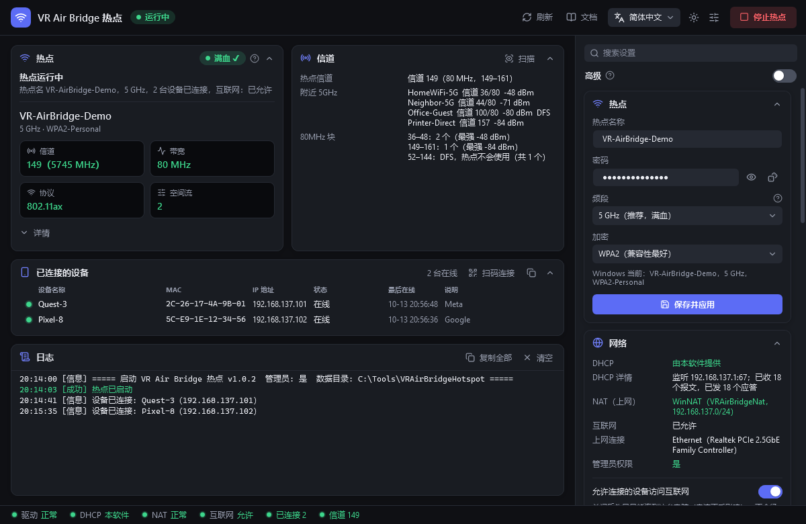
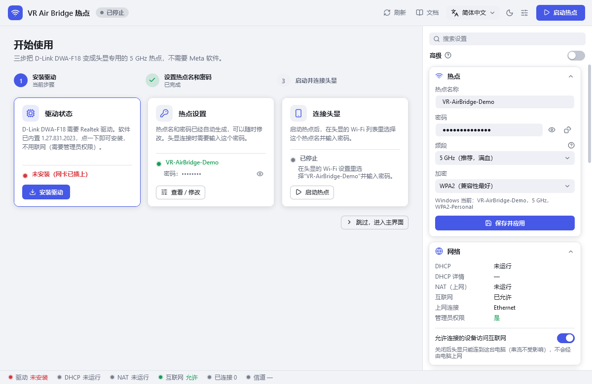
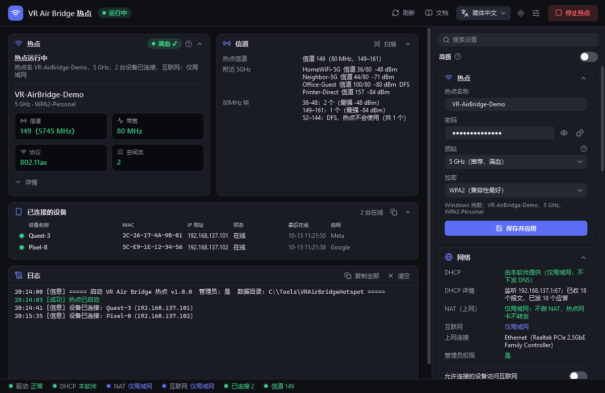
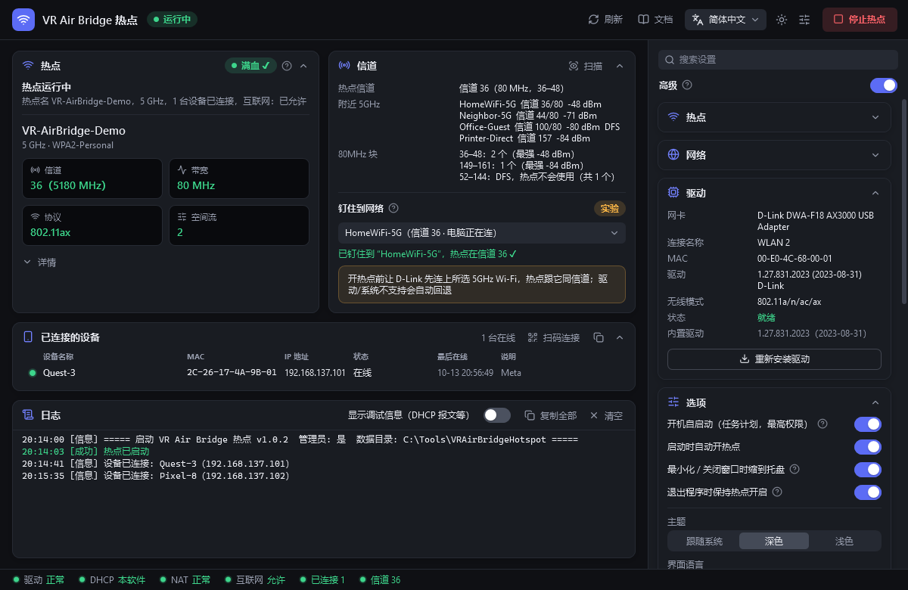
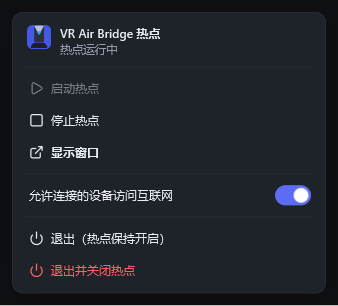
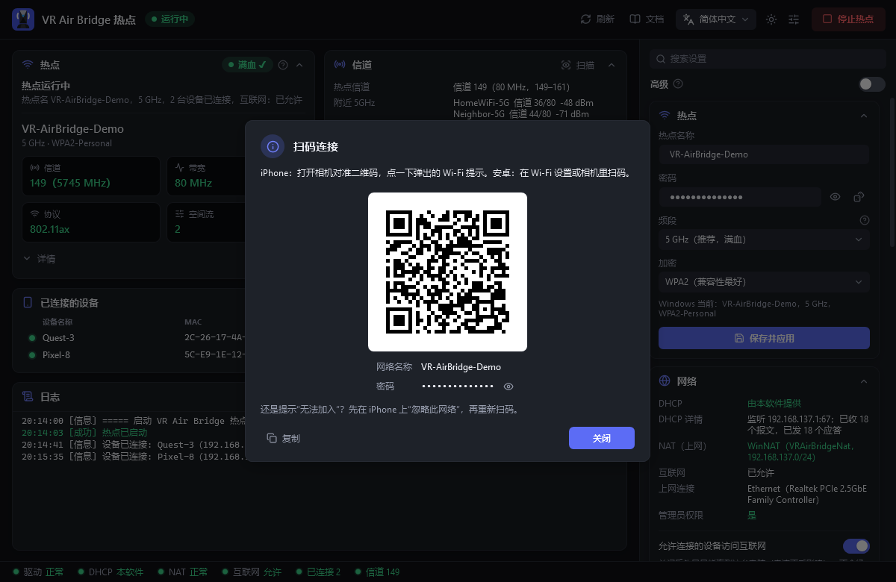
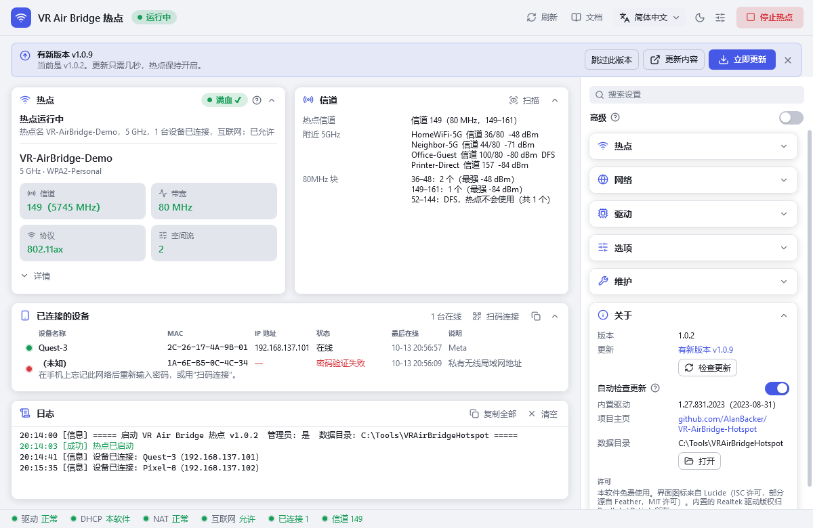

<p align="center">
  
</p>

# VR Air Bridge 热点

[English](../README.md) · **简体中文** · [日本語](README.ja.md) · [한국어](README.ko.md)

[](https://github.com/AlanBacker/VR-AirBridge-Hotspot/releases/latest)
[](https://github.com/AlanBacker/VR-AirBridge-Hotspot/actions/workflows/build.yml)
[](../LICENSE)

把 D-Link DWA-F18（Meta 的“VR Air Bridge”，Realtek RTL8852AU）变成一个独立的 5 GHz / 80 MHz / Wi-Fi 6 / 2×2 热点，用来给 Quest 串流 PC VR。
不需要 Meta 的软件，电脑自己的 Wi-Fi 照常联网。

<p align="center">
  
</p>

## 功能

- **信标核对**：从热点实际发出的信标读出信道、带宽、协议和空间流（需要另一块无线网卡）。
- **自带 DHCP 和 NAT**：不依赖 Windows 的网络共享（ICS），设备照样能拿到地址、能上网。
- **互联网开关**：关掉“允许连接的设备访问互联网”就是仅局域网，串流不受影响。
- **内置驱动**：Meta 的卸载程序会删掉网卡驱动，点“安装驱动”即可装回。
- **信道面板**：按 80MHz 块列出附近的 5GHz Wi-Fi，另有实验功能“钉住到网络”。
- **看门狗和托盘**：热点掉线自动重开，关掉窗口后在托盘里继续运行。
- **连接诊断**：设备列表会说明手机为什么连不上（密码错误、连上即断、拿不到地址）。“扫码连接”显示二维码，手机扫一下就能加入，不用手输密码。
- **自动更新**：每天检查一次 GitHub 上的新版本。点“立即更新”会下载并校验 SHA-256，几秒内重启，热点保持开启。
- **一键工具**：一键优化、修复网络、还原 / 卸载。
- **4 种界面语言**（English、简体中文、日本語、한국어），深色 / 浅色主题。

## 系统要求

- Windows 10 2004 及以上或 Windows 11，64 位。
- D-Link DWA-F18，外加一块负责电脑上网的网卡（Wi-Fi 或有线均可）。
- 管理员权限。

## 快速开始

1. 从 [Releases](https://github.com/AlanBacker/VR-AirBridge-Hotspot/releases) 下载 `VRAirBridgeHotspot-Setup.exe` 并安装，或者用便携版 `VRAirBridgeHotspot.exe`（单文件）。如果出现 SmartScreen 提示，点“更多信息”→“仍要运行”（两者都没有数字签名）。
2. 双击运行，在管理员确认窗口里点“是”。
3. 插上 DWA-F18；提示没有驱动时点“安装驱动”。
4. 首次运行会自动设置热点名 `AirBridge-XXXX` 和随机密码。要修改的话，在右侧栏“热点”里改完点“保存并应用”。
5. 点“启动热点”，让头显连上（会拿到 `192.168.137.100–199` 的地址）。然后在串流软件（Virtual Desktop、Steam Link 等）里选这台电脑。

卸载：在“设置 → 应用”里卸载即可，它会先撤销对系统的改动。便携版先点“还原 / 卸载”，再删除 exe。

<table>
  <tr>
    <td align="center" width="50%"><br>开始使用</td>
    <td align="center" width="50%"><br>仅局域网</td>
  </tr>
  <tr>
    <td align="center"><br>信道</td>
    <td align="center"><br>托盘</td>
  </tr>
  <tr>
    <td align="center"><br>扫码连接</td>
    <td align="center"><br>更新</td>
  </tr>
</table>

## 设置

设置保存在 `%LocalAppData%\VRAirBridgeHotspot\config.json`（日志也在这里），大部分都能在界面里改。v1.0.2 及更早版本放在 exe 旁边的文件，首次启动时会自动搬过去。手动编辑后，点“保存并应用”或重启软件。

| 键 | 默认值 | 含义 |
|---|---|---|
| `ssid` | `AirBridge-XXXX` | 热点名称（XXXX 是网卡 MAC 地址后 4 位） |
| `password` | 随机 12 位 | 热点密码，8–63 位英文字母、数字或符号 |
| `band` | `5GHz` | `5GHz` / `2.4GHz` / `Auto` |
| `internet.allow` | `true` | `false` = 仅局域网 |
| `channel.pinSsid` | `""` | “钉住到网络”用的 Wi-Fi；留空 = 不钉住 |
| `dhcp.*` | `auto`，`.100`–`.199`，12 小时 | 何时由本软件发地址（`auto` / `always` / `off`）、地址池、租期、备用 DNS |
| `nat.*` | `auto`，`VRAirBridgeNat` | NAT 模式（`auto` / `off`）和 WinNAT 名称 |
| `ui.language` | `auto` | `en` / `zh-CN` / `ja` / `ko`；`auto` 跟随 Windows |
| `ui.theme` | `system` | `dark` / `light`；`system` 跟随 Windows |
| `update.autoCheck` | `true` | `false` = 不自动检查更新（“关于”里的“检查更新”仍可用） |

## 命令行

本软件是窗口程序：要看到输出和退出码，请在管理员命令提示符里运行 `start /wait VRAirBridgeHotspot.exe <参数>`。

| 参数 | 作用 |
|---|---|
| `--diag [文件]` | 把诊断信息（不含密码）保存到文件（默认在数据文件夹）后退出 |
| `--driver-status` | 驱动状态；退出码 0 已安装，1 插着但没驱动，2 没插，3 查询失败 |
| `--install-driver` | 安装内置驱动 |
| `--internet on\|off` | 允许 / 禁止连接的设备上网；软件正在运行时立即生效 |
| `--lang xx` | 仅本次使用 `en` / `zh-CN` / `ja` / `ko` |
| `--uninstall` | 撤销本软件对系统的改动（同“还原 / 卸载”） |

## 常见问题

- **头显拿到 169.254.x.x**：点“修复网络”（会处理 Hyper-V 的 Default Switch）；卡巴斯基等第三方防火墙需要把热点网络设为受信任。
- **iPhone 显示“无法加入”**：先看设备列表里的提示。通常在 iPhone 上“忽略此网络”，再用“扫码连接”重新加入即可。如果仍然连上就断，关闭该网络的“私有无线局域网地址”，或改用 2.4 GHz 试试。
- **热点开在了别的网卡上**：软件按 MAC 地址识别后会自动挪到 DWA-F18，不会动电脑正在上网的网卡。
- **不是满血（2.4 GHz 或 20 MHz）**：“频段”选 5 GHz，做一次“一键优化”，重新插拔网卡后再启动。
- **卸载 Meta 软件后驱动没了**：点“安装驱动”。
- **附近另一个 Meta 网桥和你同信道**：用“钉住到网络”选一个另一 80MHz 块里、电脑保存过的 Wi-Fi。
- **能否指定信道**：不能，由 Windows 在 36–48 或 149–161 里选；“钉住到网络”是唯一能影响它的办法。
- **热点开着时 VPN 断网**：热点通过 Windows ICS 共享网络，WireGuard 等全局 VPN（如 Windscribe）可能会断网。启动热点前软件会提示；断开 VPN 或停止热点即可。只加速游戏流量的加速器（如 UU）不受影响。

## 隐私

一切都在本机完成，没有遥测。软件只会访问 GitHub：检查更新（可在“关于”里关闭），以及你点“立即更新”时下载新版本。

`config.json` 里的热点密码是明文保存的。它在你的用户目录里，不在 exe 旁边，所以 exe 可以直接分享。诊断信息不含密码，但会列出附近的 Wi-Fi 名称。

## 编译

需要 .NET 9 SDK；第二行用 [Inno Setup 6](https://jrsoftware.org/isinfo.php) 生成 `dist/VRAirBridgeHotspot-Setup.exe`。

```
dotnet publish src/VRAirBridge.App/VRAirBridge.App.csproj -c Release -o dist
iscc installer/VRAirBridgeHotspot.iss
```

## 许可

MIT，见 [LICENSE](../LICENSE)。内置的 Realtek/D-Link 驱动（1.27.831.2023，WHQL 签名）原样再分发，版权归 Realtek 所有，不在 MIT 许可范围内。

设计语言沿用 [VRChat DLSS5 Cam](https://github.com/AlanBacker/VRChat-DLSS5-Cam)；图标来自 [Lucide](https://lucide.dev)（ISC）。
